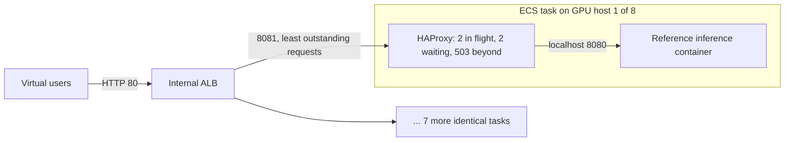

# MG Solutions server developer test: pose inference service on AWS

Submission repository for the MG Solutions server developer practical test.

The task: design the AWS server configuration for an inference service that takes one JPEG
(`POST /infer`) and returns 133 whole-body joint coordinates in 2D and 3D. Two models run in
sequence (RTMDet-x person detection, then RTMW3D-x pose estimation). The configuration is
submitted as a single CloudFormation template and graded by a 37-minute load test.

## Repository layout

| Path | Content |
| :--- | :--- |
| `exam/template.yaml` | CloudFormation template (the submission) |
| `exam/images.json` | Images other than the reference image: the official HAProxy image |
| `tests/proxy/` | Runs the proxy container exactly as the task definition describes it, under load. Runs in GitHub Actions |
| `staging/` | Deploys the template into my own AWS account and replays the fault injection before a measurement attempt is spent |

## Status

| Round | Design | Result |
| :--- | :--- | :--- |
| 1 | Reference image behind an ALB, 2 hosts scaling to 8 on request rate | 30.99 / 100 |
| 2 | Admission proxy in front of the model, 8 hosts from creation | Submitted version. Verified in CI and in staging, not measured yet |

## What round 1 measured

| Stage | Demand (requests/s) | Correct answers per second | Success |
| :--- | ---: | ---: | ---: |
| 1 | 1.7 | 1.7 | 100% |
| 2 (fault injection) | 16.7 | 4.6 | 27.67% |
| 3 | 166.7 | 1.2 | 0.69% |
| 4 | 1,666.7 | 1.3 | 0.08% |
| 5 | 6,000 | 1.0 | 0.02% |

The stack was created correctly, accuracy was 100% and the fleet did scale to 8 hosts. Three
things went wrong, and each one maps to a change in round 2:

1. **The more load arrived, the less the fleet produced.** A single request takes 121 ms (p50 at
   stages 1 and 2), so one GPU can serve about 8 requests per second and eight GPUs about 65. The
   fleet delivered 1.2. The reference server starts one thread per request with no limit; once it
   falls behind, it spends its time computing answers for clients that already timed out (the
   logs show `BrokenPipeError` when it tries to send them).
2. **The fault injection hit stage 2 while only 2 hosts were running**, each already at its limit.
   Losing one overloaded the other and the service did not recover within the stage: 470 s
   recovery time. The additional hosts needed most of the stage to become useful.
3. **Scale-in did not land inside the 6-minute cool-down.** The measured idle cost was exactly
   8 hosts plus the load balancer.

## Architecture (round 2)



- **Entry point**: one internal Application Load Balancer, the only resource the client security
  group can reach.
- **Compute**: ECS on EC2, 8 `g6.xlarge` hosts, one task per host, across two availability zones.
- **Task**: two containers sharing the task's network. HAProxy receives the traffic and forwards
  to the reference inference container on localhost. The reference image is not modified.
- **Observability**: container logs in CloudWatch Logs, four alarms (unhealthy targets, hosts
  below target, load shedding, load balancer errors), one dashboard.

## Design decisions

**Admission control in front of the model.** HAProxy lets 2 requests reach the model at a time,
keeps 2 waiting, and answers 503 immediately to the rest. The GPU only works on requests that can
still be answered in time, so throughput stays at capacity instead of collapsing, and the latency
of served requests stays low. A rejected request fails either way; rejecting it in a millisecond
keeps the capacity for a request that can succeed. `/health` bypasses the limit.

**The full fleet from creation, no scaling policy.** Round 1 measured that additional GPU hosts
need most of a 9-minute stage to boot, pull the image, load the models and pass health checks.
The load profile gives 7 minutes between the first request and stage 2. Reactive scaling cannot
meet that, so capacity is provisioned ahead of the event. The cost score counts the scored
intervals only, where the fleet is needed anyway.

**Idle cost is not optimised in this round.** A scale-in that cannot complete within the
cool-down adds risk without benefit. A faster signal is needed first (see roadmap).

**Faster failure detection.** Target health checks run every 5 s, the minimum, now that
admission control keeps the server responsive under overload.

**Security.** Client to ALB to proxy is the only inbound path, by security group reference. Tasks
have no outbound access; hosts reach AWS endpoints and S3 only. Both containers run as non-root
users on a read-only root filesystem with all capabilities dropped. IMDSv2 is enforced with hop
limit 1 and EBS volumes are encrypted.

## Verification before the measurement

A failed stack creation costs a measurement attempt, so round 2 was tested at three levels.

| Level | What ran | Result |
| :--- | :--- | :--- |
| Static | Exam pre-check and `cfn-lint` | Deployable, security 15/15, operations 5/5, no lint findings |
| Container (`tests/proxy`, GitHub Actions) | The official HAProxy image with the task definition's user, read-only filesystem, dropped capabilities, command and configuration, in front of a stand-in server | Starts; 100% served at one host's stage 2 share; at stage 3 and stage 5 shares, throughput stays at the server's capacity with p95 at 360 ms and no timeouts |
| Staging (`staging/`, my AWS account, VPC without internet) | The template with CPU hosts and a stand-in server, created by CloudFormation, then stage 2 traffic with one host terminated, then overload | Created in 289 s. Host kill: 99.67% success, two 10-second windows below 99%, then 100%. Overload at 150 requests/s: served at capacity, p95 365 ms, no timeouts, all targets healthy |

The stand-in server reproduces the reference server's structure (one thread per request, about
120 ms each), not its real speed. The same server without the proxy, at one host's stage 3
share, times out on 45% of requests with a p50 of 5 s.

## Known limitations

- **Throughput per GPU is still the reference image's.** About 8 requests per second per GPU when
  requests are processed in order; stages 3 to 5 remain far above fleet capacity.
- **Two simultaneous requests on the real model are untested.** The stand-in cannot tell whether
  the real server gains or loses from it.
- **A host loss still costs a few requests**: those in flight on the host, and those routed to it
  during the two health check intervals the load balancer needs to remove it.
- **Idle cost** stays at the full fleet.

## Roadmap

- **Round 3: custom inference image.** Dynamic batching and fp16, validated against the 1,000
  practice answers before submission. The organisers' tolerance report shows batch 16 matching
  the reference on all practice images and fp16 within tolerance on 99.2% on their pipeline;
  both have to be confirmed on my own image.
- **Scale-in on a faster signal**, for example a high-resolution metric published by the service
  itself, so the fleet can shrink within the cool-down.

## Running the checks

```bash
# static
pip install pyyaml cfn-lint
python template_check.py exam/template.yaml exam/images.json   # from the test's policy_kit
cfn-lint -t exam/template.yaml --regions ap-northeast-2

# container test (needs Docker)
bash tests/proxy/run.sh

# staging rehearsal (needs an AWS account; see staging/README.md)
bash staging/up.sh && bash staging/test.sh; bash staging/down.sh
```
