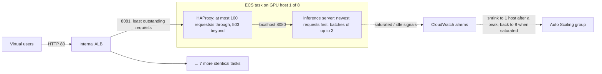

# MG Solutions server developer test: pose inference service on AWS

Submission repository for the MG Solutions server developer practical test.

The task: design the AWS server configuration for an inference service that takes one JPEG
(`POST /infer`) and returns 133 whole-body joint coordinates in 2D and 3D. Two models run in
sequence (RTMDet-x person detection, then RTMW3D-x pose estimation). The configuration is
submitted as a single CloudFormation template and graded by a 37-minute load test that goes from
1.7 to 6,000 requests per second and terminates one host on the way.

## Repository layout

| Path | Content |
| :--- | :--- |
| `exam/template.yaml` | CloudFormation template (the submission) |
| `exam/images.json` | The two images the template uses: my inference image, and the official HAProxy image |
| `inference/` | The inference server: engine, admission, HTTP front, Dockerfile, TensorRT engine build |
| `tests/inference/` | Compares the server's answers with the reference APIs, photo by photo |
| `tests/admission/` | The proxy container as the task definition describes it, in front of the real server code, under each stage's load |
| `bench/` | Measurement scripts run on an L4 GPU: throughput, per-step timing, precision study, load generator |
| `staging/` | Deploys the template into my own AWS account on GPU hosts and rehearses the load test |
| `gpu/` | A temporary self-hosted GitHub Actions runner on a `g6.xlarge`, for the GPU measurements |

## Status

| Round | Design | Result |
| :--- | :--- | :--- |
| 1 | Reference image behind an ALB, 2 hosts scaling to 8 on request rate | 30.99 / 100 |
| 2 | Admission proxy in front of the reference image, 8 hosts from creation | 59.83 / 100 |
| 3 | Own inference server (batching, TensorRT), freshest-first admission, fleet shrinks after the peak | This version. Rehearsed on GPU hosts in my account, not measured yet |

## What the first two rounds measured

| Stage | Demand (requests/s) | Round 1 success | Round 2 success |
| :--- | ---: | ---: | ---: |
| 1 | 1.7 | 100% | 100% |
| 2 (one host terminated) | 16.7 | 27.67% | 99.81% |
| 3 | 166.7 | 0.69% | 36.91% |
| 4 | 1,666.7 | 0.08% | 3.51% |
| 5 | 6,000 | 0.02% | 0.94% |

**Round 1** showed that the reference server collapses under load: it starts one thread per
request with no limit and keeps computing answers for clients that already timed out. It also
showed that a GPU host needs longer to become useful than a load stage lasts.

**Round 2** fixed both without touching the model: an admission proxy and the full fleet from
creation. The fleet then delivered what it could, 61 correct answers per second, and recovered
from the host loss in 30 s. What was left was the model's own speed: the reference pipeline
handles one request at a time in about 127 ms, so eight GPUs cannot go past 63 requests per
second, and every answer under overload waited behind three others (p50 528 ms). The fleet also
stayed at full size through the quiet period at the end.

Round 3 addresses those three points: speed per GPU, time spent waiting, and idle cost.

## Architecture (round 3)



- **Entry point**: one internal Application Load Balancer, the only resource the client security
  group can reach.
- **Compute**: ECS on EC2, 8 `g6.xlarge` hosts at creation, one task per host, two availability zones.
- **Task**: two containers sharing the task's network. HAProxy receives the traffic and forwards
  a bounded rate to the inference server on localhost.
- **Fleet size**: full from creation; shrinks to one host when the tasks report that a peak is over.
- **Observability**: container logs in CloudWatch Logs, alarms on unhealthy targets, hosts below
  target, load shedding, load balancer errors and the two fleet signals, one dashboard.

## Design decisions

### An inference server of my own, held to the reference results

The image uses the same models, weights and library versions as the reference image. What
changes is how the work is organised, and each change was accepted only after comparing its
answers with the reference pipeline on the task's 1,000 practice photos.

- **Several photos per forward pass.** Requests that arrive while the GPU is busy are processed
  together in the next pass.
- **The person box is read directly instead of going through NMS.** The task uses only the
  best-scoring person box. Class-wise NMS never removes the best-scoring box of a class, so that
  box can be read from the detector's raw output. The result is identical to the official API on
  every photo checked, and it removes 40 ms per photo: timing each step showed that NMS
  post-processing took longer than both neural networks together.
- **TensorRT engines for both networks**, built on the GPU model that serves them and included in
  the image. On the same GPU, processing a batch of three goes from 76 ms to 57 ms, and a single
  request from 49 ms to 22 ms.
- **Precision is chosen per part of the detector.** The accuracy criterion for 3D (25 mm) makes
  the person box the sensitive quantity: the estimated depth of all joints scales with the box
  size, so for a small, distant person a box off by a tenth of a pixel is enough to fail.
  Measured on the practice photos: the pose network can run in fp16 at no cost (99.9% within
  tolerance when given exact boxes), and so can the detector's backbone and the bottom-up half of
  its neck; the top-down half of the neck and the head stay in fp32. TensorRT's TF32 mode is
  switched off: it is enabled by default and silently gives "fp32" layers about the precision of
  fp16 (with it, the fp32 engine reproduced 98.7% of the reference results; without it, its
  boxes are identical on all 1,000 photos).
- **An engine is used only if it reproduces the PyTorch outputs.** At start-up the server compares
  each engine with the PyTorch network on a check input. If an engine is missing, fails to load
  (another GPU model) or fails the check, that network runs in PyTorch and the service still works.

| Configuration (L4, practice photos) | Photos/s, batch of 3 | Within tolerance |
| :--- | ---: | ---: |
| Reference pipeline (PyTorch fp32, one photo at a time, NMS) | 7.7 | 100% |
| PyTorch, fp16 backbones, direct box | 39.8 | 99.1% |
| TensorRT, detector entirely in fp32 (TF32 off) | 31 | 99.7% |
| **TensorRT, precision per part (this version)** | **52.4** | **98.5%** |
| TensorRT, detector backbone and whole neck in fp16 | 62.5 | 97.6% |

The required accuracy is 95%. I kept a margin rather than the fastest configuration because the
final ranking is measured on photos I have not seen.

### Under overload, answer the freshest requests

Stages 4 and 5 send ten to forty times what the fleet can compute. Most requests will be refused
whatever the design; the question is which ones are served and how long they wait.

- **HAProxy** lets at most 100 requests per second through to each inference server and answers
  503 to the rest without involving the server. It also holds a hard limit on requests inside the
  server, should it stall. `/health` bypasses both.
- **The inference server** keeps decoded requests in a small pen and serves the newest ones.
  When the pen is full, each arrival pushes the oldest waiting request out, and it is answered
  503 at once. An admitted request therefore waits about one batch, however large the excess.
  With a first-come-first-served queue, as in round 2, every answer waits for the whole queue.

Below capacity none of this is visible: a request is processed alone, immediately.

### Full fleet from creation, one host after the peak

A GPU host needs about five minutes to become useful (boot, image pull, model load, health
checks). The load profile gives less than that between stages, so the fleet starts at eight
hosts and is not grown reactively during the test.

The quiet period at the end is different: capacity is not needed and the cost of its last three
minutes is scored. Each inference server reports two signals from its own traffic: *saturated*
(it is turning requests away) and *idle* (it has been through a period of saturation, and now
receives a small fraction of its capacity). When most tasks report idle, an alarm shrinks the
Auto Scaling group to one host; when most report saturated, another brings it back to eight.
The idle signal cannot fire before a first peak, so a fleet that has just started is not shrunk
because nobody has called it yet, and the host loss early in the test meets a full fleet.

The signal reaches CloudWatch on two paths: as a high-resolution metric published by the task,
and as a log line counted by a metric filter, which needs no API call from the task.

### Security

Client to ALB to proxy is the only inbound path, by security group reference. Tasks reach the AWS
endpoints only (for the metrics); hosts reach the AWS endpoints and S3. Both containers run as
non-root users on a read-only root filesystem with all capabilities dropped. IMDSv2 is enforced
with hop limit 1 and EBS volumes are encrypted.

## Verification before the measurement

A failed stack creation costs a measurement attempt and the last one cannot be repeated, so the
submission was tested at four levels.

| Level | What ran | Result |
| :--- | :--- | :--- |
| Static | Exam pre-check and `cfn-lint` | Deployable, security 15/15, operations 5/5, no lint findings |
| Answers (`tests/inference`, `bench/`) | The published image on an L4, the 1,000 practice photos sent over HTTP through the proxy, each answer compared with the reference pipeline's | 98.5% within the task's tolerance. My reference run reproduces the organisers' practice answers on all 1,000 photos |
| Admission (`tests/admission`, GitHub Actions) | The official HAProxy image exactly as the task definition runs it, in front of the real server code with a stand-in engine, at one host's share of each stage | Every request answered at stages 1 to 3; at stages 4 and 5 answers at the engine's capacity, p99 under 200 ms, no timeouts, no answer returned to the wrong request |
| Staging (`staging/`, my AWS account, VPC without internet) | The submitted template, unchanged, on `g6.xlarge` hosts, driven by a load client in the VPC | See below |

Staging rehearsal of this version (two hosts, the load scaled so that each host receives the
share of one of the exam's eight):

| Check | Result |
| :--- | :--- |
| Stack creation | 648 s (limit 1,200 s) |
| Engines on the hosts | Both hosts started with both networks in TensorRT |
| Stage 1 to 3 shares | Every request answered; p50 30 ms, p99 41 ms at the stage 3 share |
| Overload (750 requests/s) | 51.7 correct answers per second per host, p50 85 ms, p95 109 ms, no timeouts |
| After the peak | Idle alarm 44 s after the load dropped, group at one host about a minute after |
| One host terminated at stage 2 load (first rehearsal) | 19 requests lost in the 9 s the load balancer needed to stop routing to the host, none afterwards |

For comparison, round 2 measured 7.7 correct answers per second per host and a p50 of 528 ms.

## Known limitations

- **Stages 4 and 5 remain far above capacity.** About 410 correct answers per second for the
  fleet, against 1,667 and 6,000 requested. Closing that gap needs more or larger GPUs than the
  task allows.
- **Accuracy is 98.5% on the practice photos, not 100%.** The failures are photos with a small,
  distant person, where the fp16 parts move the box by a fraction of a pixel.
- **The engines are specific to the GPU model** (L4) and TensorRT version. On anything else the
  server runs in PyTorch, at about two thirds of the speed.
- **A host loss still costs a few requests**: those in flight on the host, and those routed to it
  until the load balancer's health checks remove it.
- **Growing back takes minutes.** After the fleet has shrunk, a new peak is served by one host
  until the others have started.
- **The rehearsal uses two hosts**, my GPU quota. The load balancer and the fleet have not been
  driven at 6,000 requests per second outside the measurement itself.

## Running the checks

```bash
# static
pip install pyyaml cfn-lint
python template_check.py exam/template.yaml exam/images.json   # from the test's policy_kit
cfn-lint -t exam/template.yaml --regions ap-northeast-2

# admission test (needs Docker)
pip install aiohttp==3.9.5 "numpy<2" "opencv-python-headless<4.11"
bash tests/admission/run.sh

# answers against the reference APIs, on CPU (needs Docker, about 15 minutes)
bash tests/inference/run.sh

# staging rehearsal on GPU hosts (needs an AWS account; see staging/README.md)
bash staging/up.sh && bash staging/test.sh; bash staging/down.sh
```
