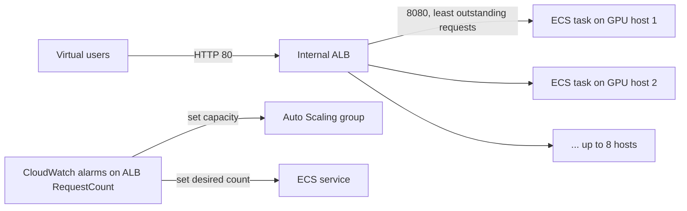

# MG Solutions server developer test: pose inference service on AWS

Submission repository for the MG Solutions server developer practical test.

The task: design the AWS server configuration for an inference service that takes one JPEG
(`POST /infer`) and returns 133 whole-body joint coordinates in 2D and 3D. Two models run in
sequence (RTMDet-x person detection, then RTMW3D-x pose estimation). The configuration is
submitted as a single CloudFormation template and graded by a 37-minute load test.

## Repository layout

| Path | Content |
| :--- | :--- |
| `exam/template.yaml` | CloudFormation template (the submission) |
| `exam/images.json` | Custom image list. `{}` for now: this round uses the reference inference image |

## Status

| Check | Result |
| :--- | :--- |
| Template pre-check (local `template_check.py` and the test site) | Deployable, security 15/15, operations 5/5 |
| `cfn-lint` (ap-northeast-2) | No errors or warnings |
| Maximum configuration cost | $7.93/hour, at most $8.20 per measurement |
| Real deployment and load test | **Not run yet** |

Everything below about runtime behaviour is design intent until the first measurement confirms it.

## The problem in numbers

The load test raises traffic tenfold per stage, and the template may use at most 8 GPU instances.
Dividing each stage by 8 gives the throughput every GPU must sustain:

| Stage | Requests/s | Needed per GPU (8 GPUs) |
| :--- | ---: | ---: |
| 1 | 1.67 | 0.2 |
| 2 | 16.67 | 2.1 |
| 3 | 166.67 | 20.8 |
| 4 | 1,666.67 | 208 |
| 5 | 6,000 | 750 |

The reference design notes that the reference image handles about 120 requests per minute per GPU,
which is 2 requests/s. Result caching is forbidden and every request carries random bytes.

Three conclusions drive the design:

1. **Per-GPU throughput is the dominant lever.** With the reference image the fleet saturates in
   stage 2. No load balancer or scaling setting changes that; only a faster inference image does.
2. **Nobody serves the peak fully.** What matters at saturation is how the service fails: quickly
   and cleanly, while still serving at full capacity.
3. **Capacity must be ready before a stage starts.** A GPU host needs minutes to boot and pull the
   image, and each stage lasts 5 to 9 minutes.

## Architecture (v1.1)



- **Entry point**: one internal Application Load Balancer, the only resource the client security
  group can reach.
- **Compute**: ECS on EC2, `g6.xlarge`, one inference task per GPU host (`distinctInstance`),
  spread across the two availability zones.
- **Scaling**: two CloudWatch alarms on the ALB request rate drive both the Auto Scaling group and
  the ECS service, so hosts and tasks stay one to one.
- **Observability**: container logs in CloudWatch Logs, four alarms, one dashboard (requests and
  errors, response time percentiles, host count).

## Design decisions

**Two fixed operating points instead of target tracking.** Tracking requests per target reacts
after the load has arrived, and then waits for hosts to boot. The load profile only has two
regimes, so the template has two:

| Traffic on the ALB | Capacity |
| :--- | :--- |
| Above 200 requests/min | 8 hosts (the quiet phases send 100/min, stage 2 sends 1,000/min) |
| Below 150 requests/min | 2 hosts |

The thresholds do not overlap, so the two alarms never fight. The quiet alarm is also active at the
start of the run, where it sets the capacity the stack was created with and changes nothing.

**No ECS capacity provider.** Managed scaling removes idle hosts only after a long observation
window, on the order of 15 minutes. The cool-down phase lasts 6 minutes and its cost is scored, so
the Auto Scaling group is driven directly by the alarms.

**Two hosts at rest, not one.** One instance is terminated without notice during the test. With two
hosts the service keeps answering whenever that happens. Running a second idle host costs a little
on the sustainability score and protects the 20 stability points.

**Container settings equal the reference design.** CPU, memory, health check timings and grace
period are the published reference values. They are changed only when a measurement justifies it.

**Security.** Client to ALB to task is the only inbound path, by security group reference. Tasks
have no outbound access; hosts reach AWS endpoints and S3 only. Containers run as a non-root user
on a read-only root filesystem with all capabilities dropped. IMDSv2 is enforced with hop limit 1
and EBS volumes are encrypted.

## Known limitations

- **Scale-in picks hosts and tasks independently.** The Auto Scaling group and ECS each choose what
  to keep. A kept task can sit on a terminated host and be restarted on a surviving one. This
  happens in the cool-down phase, where the success rate is not scored.
- **Alarm latency.** ALB metrics have one-minute resolution, so each scaling decision trails the
  traffic change by a minute or more.
- **Behaviour at saturation is unknown** for the reference image: whether it queues until the
  10-second client timeout or rejects early. The first measurement will show it.

## Roadmap

1. **Round 1: baseline.** This template with the reference image. Goal: confirm stack creation,
   scaling timing, behaviour during fault injection, and get real scores.
2. **Custom inference image, in steps**, each validated against the 1,000 practice answers with the
   practice load tool before it is submitted:
   1. Admission control: reject immediately when the queue is full instead of timing out.
   2. Dynamic batching. The published tolerance report shows batch 16 matches the reference
      on all 1,000 practice images.
   3. fp16, only if accuracy holds. The same report shows 99.2% of images within tolerance
      with fp16, above the 95% qualification line.
3. **Rounds 2 and 3**: the custom image, then corrections based on the report.

## Checking the template locally

```bash
pip install pyyaml cfn-lint
python template_check.py exam/template.yaml exam/images.json   # from the test's policy_kit
cfn-lint -t exam/template.yaml --regions ap-northeast-2
```
